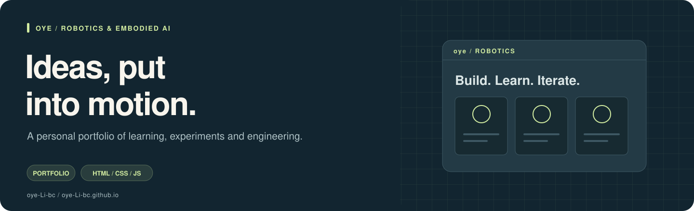

# oye · Robotics Portfolio




[](https://oye-li-bc.github.io/)

〇也（oye）的机器人与具身智能个人作品集源码，展示强化学习、模仿学习、真机部署与结构设计项目。

**[打开在线主页](https://oye-li-bc.github.io/) · [项目索引](#projects) · [本地预览](#preview) · [编辑说明](#editing)**

## 页面内容

单页静态网站，包含中英文切换、项目筛选、可展开技术详情、图片放大查看和简历入口。
入口为 [index.html](index.html)，现有项目图片与演示资源位于仓库根目录。

<a id="projects"></a>

## 项目索引

| 项目 | 内容 | 入口 |
|---|---|---|
| HIL-SERL 推物体 | 人在环在线强化学习、标定与真机实验 | [仓库](https://github.com/oye-Li-bc/so101-hilserl-pushing) |
| SmolVLA 抓取 | 视觉语言动作模型微调、数据与部署 | [仓库](https://github.com/oye-Li-bc/so101-smolvla-grasping) |
| ACT 抓取 | 示教、动作块策略训练与部署 | [仓库](https://github.com/oye-Li-bc/so101-act-grasping) |
| PacePal 机器人 | 两代样机的结构设计与工程记录 | [主页项目区](https://oye-li-bc.github.io/#projects) |
| 两轮自平衡 | PPO、Isaac Lab 与 MuJoCo 迁移 | [仓库](https://github.com/oye-Li-bc/two-wheel-balance-rl) |

另有[研究工作流 Skills](https://github.com/oye-Li-bc/research-workflow-skills)，收录论文、Notebook 与研究笔记相关工作流。

<a id="preview"></a>

## 本地预览

无需构建步骤。有 Python 时可在仓库目录运行：

```sh
python -m http.server 8000 --bind 127.0.0.1
```

随后访问 <http://127.0.0.1:8000>。在线页面由本仓库的 GitHub Pages 提供。

<a id="editing"></a>

## 编辑说明

| 修改内容 | 位置 |
|---|---|
| 页面文字与项目资料 | `index.html` 中对应的项目卡片与详情 |
| 中英文内容 | 成对编辑 `lang-zh` / `lang-en` 元素 |
| 颜色和基础样式 | 内联样式的 `:root` 变量 |
| 项目演示、照片与曲线 | 根目录现有媒体文件及其页面引用 |

更新时保留资料来源、实验条件与图片说明；用桌面和手机宽度检查排版，再检查切换语言、筛选、展开详情和图片放大。

封面是原创示意插图，实际网站效果请打开在线主页查看；[图片说明](.github/readme/README.md)。
